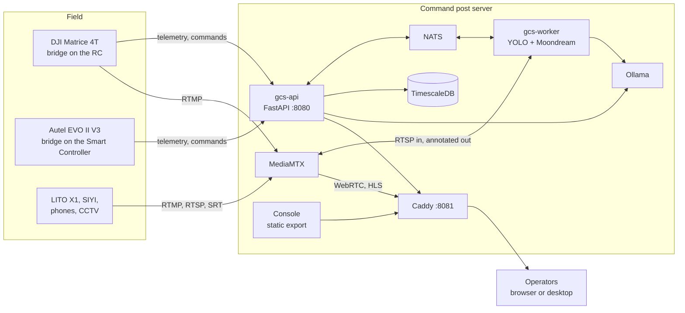

<div align="center">


# PASUPASASTRA

**Unified Command Center For Multi-drone Operations: DJI and Autel drones, phones and CCTV on one
3D map, flight commands and waypoint missions, payload drop, live video with multi-model AI
detection and scene captions, a visual Q&A assistant. Runs on one local server, no cloud
required.**

[](https://github.com/DarmawanWeb/Pasupasastra/actions/workflows/validate.yml)
[](https://github.com/DarmawanWeb/pasupasastra-gcs-fe/actions/workflows/ci.yml)
[](https://github.com/DarmawanWeb/pasupasastra-gcs-be/actions/workflows/ci.yml)
[](https://github.com/DarmawanWeb/pasupasastra-bridge-dji-matrice-4t/actions/workflows/ci.yml)
[](https://github.com/DarmawanWeb/pasupasastra-bridge-autel-evo2-v3/actions/workflows/ci.yml)
<br>


[](LICENSE)

[Features](#features) · [System](#system) · [Try it](#try-it) · [Deploy](#deploy) ·
[Connect the drones](#connect-the-drones) · [Performance](#performance) ·
[Documentation](#documentation) · [Develop](#develop)

</div>

---

PASUPASASTRA is a ground control station for flying many drones from different vendors from one
console. Operators see the whole fleet on one map, watch video from drones, phones and CCTV, run
object detection and scene analysis on it, and send flight commands and waypoint missions to the
drones that support them. Everything runs on a server at the command post (a Mac mini M4, or Linux
with an NVIDIA GPU); the operator interface is in Bahasa Indonesia.

This repository is the **deployment root**: the infrastructure at the top level; the console, the
backend and the drone bridges in submodules.

## Features

**Fleet**
- DJI Matrice 4T and Autel EVO II V3 live over their bridges, plus simulated demo drones, on a
  CesiumJS 3D globe with heading and live tracks.
- Link state (connected, degraded, lost, offline) and events: takeoff, landing, battery, RC signal.
- Every flight is recorded to TimescaleDB; replay the track, export GPX, export the event log to CSV.

**Fly**
- QGroundControl-style fly view: mode, arm state, GPS, battery, link, flight time, mission progress.
- Takeoff, land, return to home, hold, go to point and payload release, each behind slide-to-confirm.
- Attitude indicator, compass with home bearing, the drone's video picture-in-picture.

**Plan**
- Click to add waypoints, drag to move; altitude, speed, hold and action per waypoint.
- Survey (lawnmower) generator, patrol repeat, distance, duration and battery estimate.
- Save, load, import and export plans; upload and start. DJI runs them as KMZ (WPML), Autel as
  native waypoint missions.

**Payload drop**
- Targets from the map or typed in decimal degrees, MGRS or a pasted "lat, lon".
- Assign a drone, drop altitude and approach speed; follow
  `enroute → stabilizing → released → returning → completed`, or cancel.

**Video and AI**
- RTMP, RTSP, SRT and HLS in, WebRTC (WHEP) and HLS out through MediaMTX: drone cameras, LITO X1,
  SIYI, phones and IP cameras, with the DJI RGB and thermal lens switch.
- Several YOLO models per stream at once (`.pt`, `.onnx`, TensorRT `.engine`, CoreML), with
  threshold, every-N-frames, class filter and colour changed live; group counts such as people and
  vehicles.
- Annotated video re-published as `ai/<path>`, Moondream scene captions translated to Indonesian,
  and a visual Q&A assistant with speech-to-text.

**Safety and operations**
- A bridge executes commands only while its **Izinkan kendali dari GCS** interlock is on; the
  console disables what a bridge cannot do and says why.
- Limits checked on the server and again in the bridge: altitude 5–120 m, 1000 m from the drone,
  10 m/s, 99 waypoints. Every command is acknowledged by the bridge and written to an audit log.
- Roles (admin, operator, observer), web and Tauri desktop app, a full in-browser demo mode for
  training without a server.

## System



| Path | Repository | |
|---|---|---|
| [`fe/`](https://github.com/DarmawanWeb/pasupasastra-gcs-fe) | `pasupasastra-gcs-fe` | Operator console: Next.js 16 static export and Tauri 2 desktop app, CesiumJS, demo mode |
| [`be/`](https://github.com/DarmawanWeb/pasupasastra-gcs-be) | `pasupasastra-gcs-be` | `gcs-api` (FastAPI: bridges, commands, missions, recording, streams, VLM, STT) and `gcs-worker` (multi-model YOLO, Moondream) |
| [`bridges/`](https://github.com/DarmawanWeb/PasupasastraBridge) | `PasupasastraBridge` | The drone bridges and their [protocol](https://github.com/DarmawanWeb/PasupasastraBridge/blob/main/PROTOCOL.md), one submodule per drone model: |
| [`bridges/dji-matrice-4t/`](https://github.com/DarmawanWeb/pasupasastra-bridge-dji-matrice-4t) | `pasupasastra-bridge-dji-matrice-4t` | DJI Matrice 4T: Flutter and DJI MSDK v5.17 on the RC Plus 2; telemetry, RTMP video, commands, KMZ missions |
| [`bridges/autel-evo2-v3/`](https://github.com/DarmawanWeb/pasupasastra-bridge-autel-evo2-v3) | `pasupasastra-bridge-autel-evo2-v3` | Autel EVO II V3: Flutter and Autel SDK v1.5 on the Smart Controller V3; telemetry, commands, waypoint missions |
| `docker-compose.yml` | | MediaMTX, TimescaleDB, NATS, the API and Caddy; `--profile gpu` adds the worker and Ollama |
| `Caddyfile` | | one origin on :8081: the console, `/api`, `/webrtc`, `/hls` |
| `mediamtx/`, `worker/` | | media server config; caption prompts and count groups (hot reloaded) |
| `pm2/`, `scripts/` | | the native worker on macOS (CoreML, Metal, VideoToolbox); Mac setup and deploy scripts |
| `cloudflared/` | | example Cloudflare Tunnel for remote access to the console |
| `docs/` | | [user manual (PDF)](docs/PASUPASASTRA-Manual-Pengguna.pdf) and its LaTeX source, benchmark results |

## Try it

The console simulates the whole backend in the browser when it is built without an API URL: flight
physics, missions, payload drop, failsafes, video and AI.

```bash
git clone https://github.com/DarmawanWeb/pasupasastra-gcs-fe.git && cd pasupasastra-gcs-fe
npm ci && npm run dev    # http://localhost:3000, log in as operator / pasupati
```

## Deploy

**Mac mini (Apple Silicon).** Docker runs MediaMTX, TimescaleDB, NATS, the API and Caddy; the
inference worker and Ollama run natively under PM2 to use CoreML, Metal and VideoToolbox.

```bash
git clone --recursive https://github.com/DarmawanWeb/Pasupasastra.git && cd Pasupasastra
scripts/setup-mac.sh     # ffmpeg, Python 3.12 venv, Ollama (moondream, llama3.2:3b), PM2
cp .env.example .env     # LAN_IP, POSTGRES_PASSWORD, GCS_JWT_SECRET, GCS_ADMIN_PASSWORD
scripts/deploy.sh        # builds the console, starts the stack and the worker
pm2 startup              # once: start the worker at boot
```

Open `http://<LAN_IP>:8081`, log in as `admin` with `GCS_ADMIN_PASSWORD` and change the password in
**Pengaturan**. Operators are created with
`docker compose exec api gcs-admin create-user --username op1 --display-name "Operator 1" --role operator`.

**Linux with an NVIDIA GPU.** `scripts/deploy.sh --gpu` runs the CUDA worker and Ollama in
containers as well. CoreML models (`.mlpackage`) only run on the macOS worker.

<details>
<summary><b>Updates, CI images, backups, remote access</b></summary>

- Updates: `scripts/deploy.sh` pulls this repository and its submodules, rebuilds the console and
  the images and reloads the worker; database migrations run when the API starts.
  `scripts/deploy.sh --pull` uses the API image from CI (`ghcr.io/darmawanweb/pasupasastra-api`)
  instead of building it.
- The console's API URL is baked in at build time: `http://<LAN_IP>:8081/api`, or `CONSOLE_API_URL`
  in `.env`. The Tauri desktop app is built from `fe/` with the same variable.
- Backups: `docker compose exec postgres pg_dump -U gcs gcs > backup.sql`.
- Remote access: Cloudflare Tunnel (`cloudflared/config.example.yml`) carries HTTP only, so the
  console, API and WebSocket work but WebRTC media does not; watch live video over a VPN
  (WireGuard, Tailscale) to the command post network.

</details>

## Connect the drones

| Device | Sends to |
|---|---|
| DJI Matrice 4T bridge, telemetry and commands | `ws://<LAN_IP>:8080/telemetry/m4t-001` |
| DJI Matrice 4T bridge, video | `rtmp://<LAN_IP>:1935/m4t` |
| Autel EVO II V3 bridge | `ws://<LAN_IP>:8080/ws/drone` |
| LITO X1, SIYI, phones, CCTV | `rtmp://<LAN_IP>:1935/live/<name>` |

Register each drone in the console with the same ID as its bridge, and its video source with the
same RTMP URL; phones and CCTV go on the **Kamera** page. With `GCS_BRIDGE_TOKEN` set, bridges append
`?token=<token>`. The messages are in the
[bridge protocol](https://github.com/DarmawanWeb/PasupasastraBridge/blob/main/PROTOCOL.md); new drones
get their own bridge in [PasupasastraBridge](https://github.com/DarmawanWeb/PasupasastraBridge#add-a-drone).

| Port | | Port | |
|---|---|---|---|
| 8080 | API, realtime WebSocket, bridges | 8554 | RTSP (worker in and out) |
| 8081 | console and API proxy (Caddy) | 8889, 8189/udp | WebRTC (WHEP), media |
| 1935 | RTMP in | 8888 | HLS |
| 8890/udp | SRT in | | |

Every published port is a variable in `.env` (`GCS_CONSOLE_PORT`, `GCS_API_PORT`, `GCS_RTMP_PORT`,
`GCS_RTSP_PORT`, `GCS_WEBRTC_PORT`, `GCS_WEBRTC_UDP_PORT`, `GCS_HLS_PORT`, `GCS_SRT_PORT`, and the
loopback-only `GCS_DB_PORT`, `GCS_NATS_PORT`, `GCS_OLLAMA_PORT`).

<details>
<summary><b>Running next to NETRA, Molly and other stacks on one host</b></summary>

Compose projects, networks and volumes are already separate (`pasupasastra_*`), so only host ports
can collide. NETRA takes 80 and 443 (or 8088 behind a tunnel), PM2 dashboards usually 3000–3099, and a
host TimescaleDB 5432; PASUPASASTRA keeps its database and NATS on loopback 15432 and 14222. On a
shared Mac mini where 8080 is taken, for example:

```dotenv
GCS_CONSOLE_PORT=8091
GCS_API_PORT=8092
```

then point the bridges at `ws://<LAN_IP>:8092/...` and the tunnel at `http://localhost:8091`.
`scripts/deploy.sh` checks every port before the first start and stops with the ones that are taken.

</details>

## Performance

Measured with [`be/tests/bench.py`](https://github.com/DarmawanWeb/pasupasastra-gcs-be/blob/main/tests/bench.py)
against the running stack on a deliberately small machine (1 vCPU Xeon 2.1 GHz, 3 GB RAM);
[raw results](docs/bench-sandbox.json).

| Measurement | Result | |
|---|---|---|
| Telemetry ingest | 196 msg/s | 20 drones at 10 Hz for 15 s, nothing dropped on the server |
| API process during that load | 5.3 % CPU, 76 MB | |
| Bridge to operator screen | 45 ms p50, 98 ms p95 | includes the 5 Hz broadcast coalescing |
| Command to bridge acknowledgement | 11 ms p50, 21 ms p95 | 100 commands |
| REST `/drones`, `/streams` | 5.5 ms, 4.8 ms p50 | 300 requests each |
| Worker pipeline (ONNX test model) | 6.9 ms/frame | pre-processing and NMS on the CPU |

## Documentation

| For | Document |
|---|---|
| Operators and whoever deploys the system | [Manual Pengguna (PDF, Indonesian)](docs/PASUPASASTRA-Manual-Pengguna.pdf): architecture, deployment, bridges, video, the console, AI, safety, performance, troubleshooting |
| Bridge developers | [Bridge protocol](https://github.com/DarmawanWeb/PasupasastraBridge/blob/main/PROTOCOL.md): endpoints, telemetry formats, capabilities, commands, missions, events; [adding a drone](https://github.com/DarmawanWeb/PasupasastraBridge#add-a-drone) |
| Console developers | [pasupasastra-gcs-fe](https://github.com/DarmawanWeb/pasupasastra-gcs-fe): structure, backend contract, desktop build |
| Backend developers | [pasupasastra-gcs-be](https://github.com/DarmawanWeb/pasupasastra-gcs-be): services, API, configuration, models, tests |
| Building the bridge apps | [DJI Matrice 4T](https://github.com/DarmawanWeb/pasupasastra-bridge-dji-matrice-4t) and [Autel EVO II V3](https://github.com/DarmawanWeb/pasupasastra-bridge-autel-evo2-v3) bridge READMEs |

## Develop

```bash
git submodule update --init --recursive
lefthook install          # in the root and in each submodule
make -C docs/manual       # rebuild the user manual (XeLaTeX)
```

The `validate` workflow checks the compose file, the Caddyfile, the PM2 config, the shell scripts and
that every submodule pointer resolves, on every push; each submodule has its own CI. After committing
in a submodule, commit the new submodule pointer here (for a bridge: in `bridges/` first, then here).

Proprietary: © 2026 I Wayan Agus Darmawan (DarmawanWeb), all rights reserved. See [LICENSE](LICENSE).
